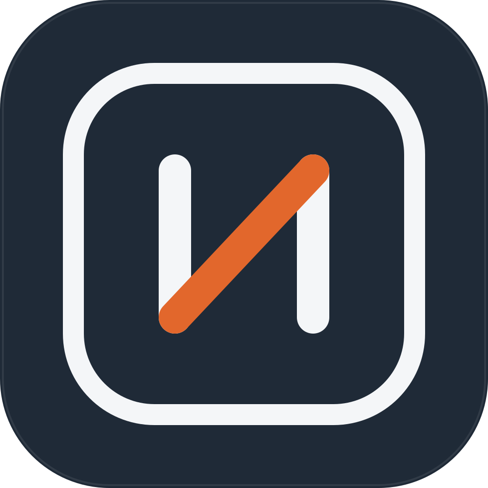
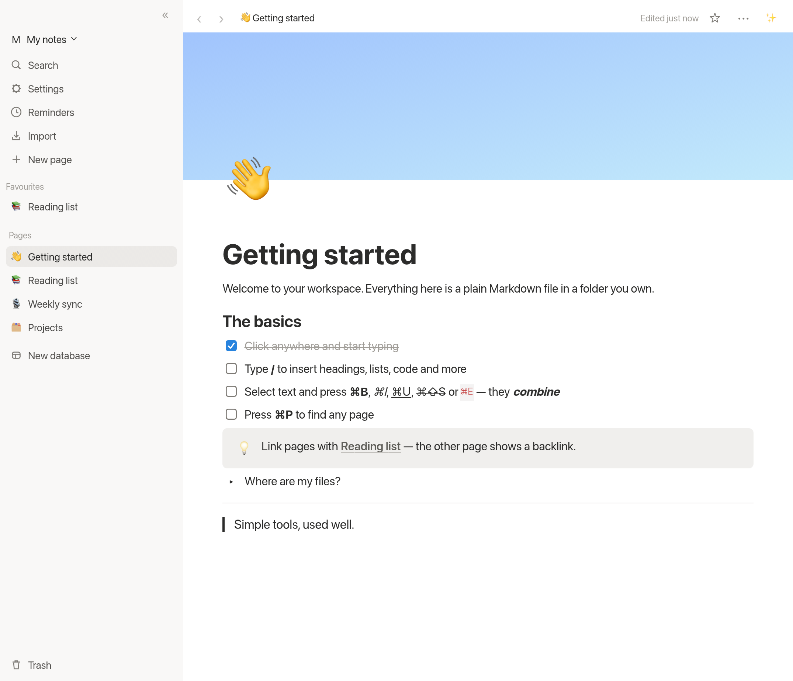
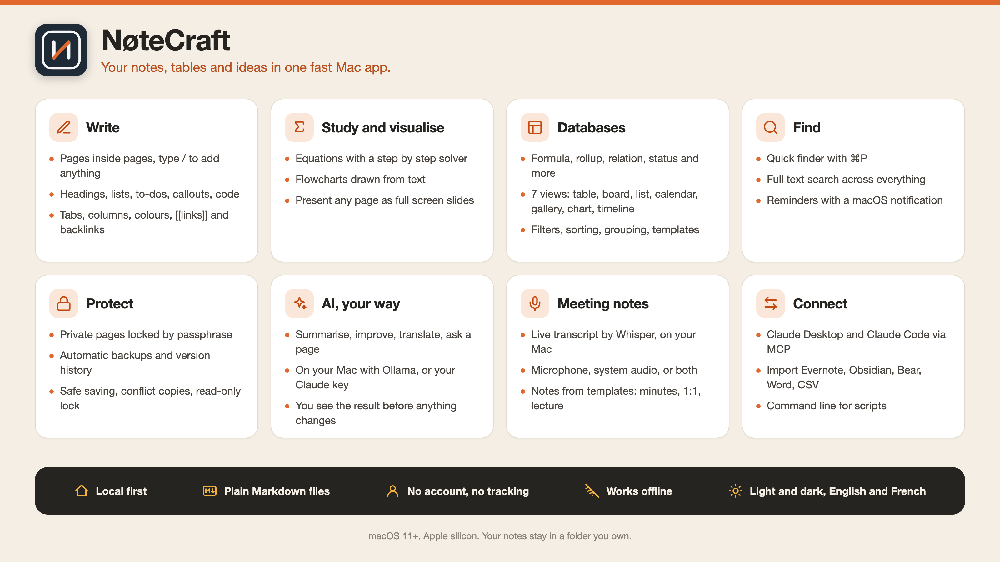
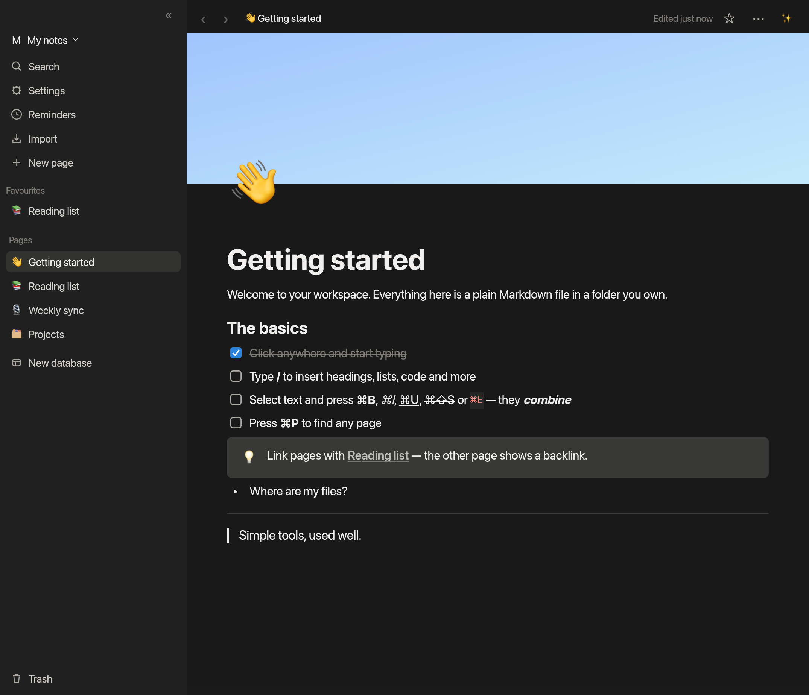
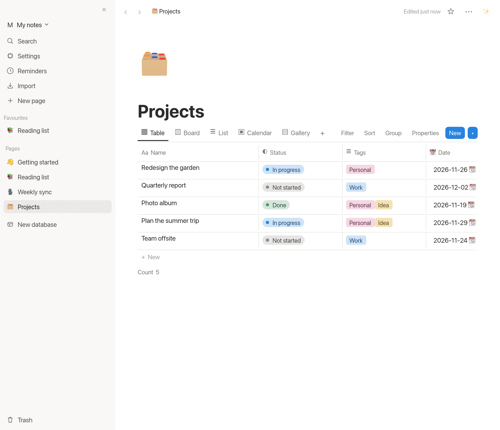
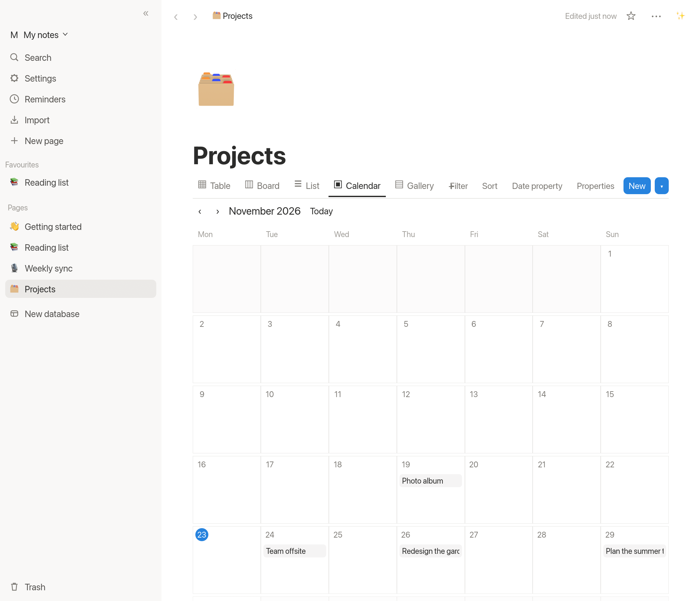
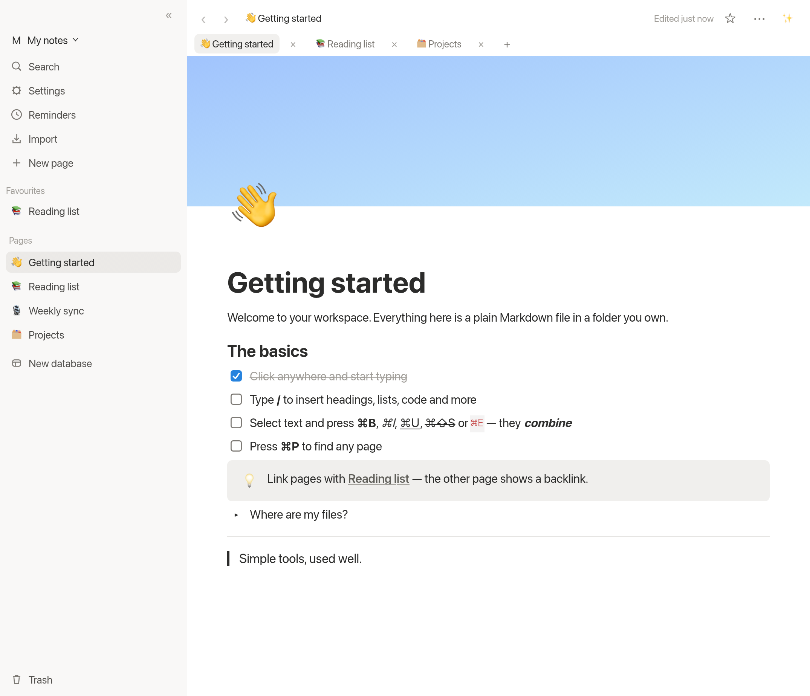
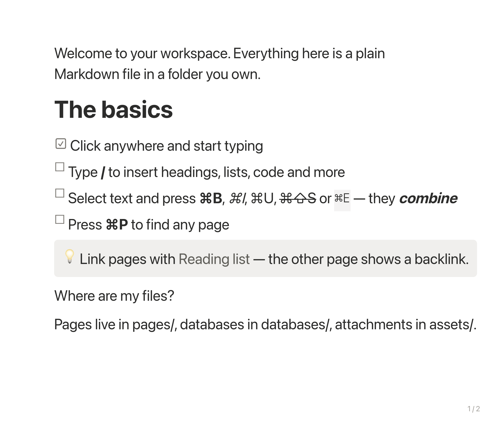
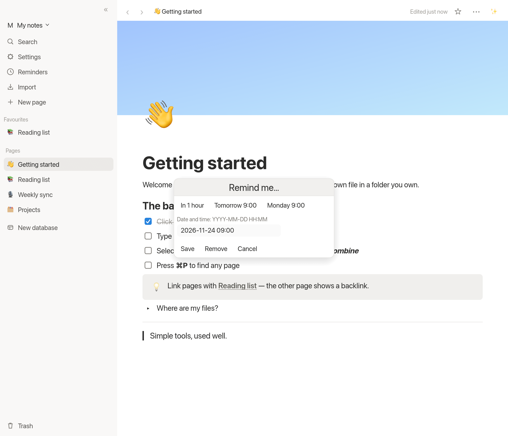

# NøteCraft

**Your notes, tables and ideas in one fast Mac app. Everything stays as ordinary files in a folder you own.**

No account. No tracking. No subscription. Works offline.

## At a glance

## Why NøteCraft

| | |
|---|---|
| **Yours** | Each page is a Markdown file in a folder you choose. Open it with any app, back it up like any folder, sync it with iCloud Drive, Dropbox or kDrive. |
| **Private** | No account, no telemetry, no connection to the internet on its own. Private pages are encrypted with your passphrase, and your Claude key stays in the macOS Keychain. |
| **Fast** | A native app written in Rust: it opens at once, searches instantly and stays responsive. |
| **Open to AI, on your terms** | Use Ollama on your Mac, or your own Claude or ChatGPT key. Claude Desktop and Claude Code can read and edit your notes through MCP, with permissions you control. |

## Download and install

1. Download **NoteCraft.dmg** from the [latest release](../../releases/latest).
2. Open it and drag **NøteCraft** into **Applications**.
3. First launch: the app is not signed with an Apple developer certificate yet, so macOS blocks it once. Right-click the app and choose **Open**; if that is not offered, open **System Settings, Privacy & Security** and click **Open Anyway**.
4. Pick a folder for your notes.

Requires macOS 11 or later (Apple silicon).

## Learn more

Everything the app does, the keyboard shortcuts and how your data is handled are in the [user guide](docs/user-guide.md).

## Screenshots

| Dark mode | Table |
|---|---|
|  |  |
| **Board** | **Calendar** |
|  |  |
| **AI assistant** | **Meeting notes** |
|  |  |
| **Tabs** | **Presentation** |
|  |  |
| **Reminders** | |
|  | |

## For developers and curious people

Build instructions, the file format, how sync and conflicts work, the assistant (MCP) server and the architecture are in the [technical guide](docs/technical.md) and [architecture notes](docs/architecture.md).

## License

Personal, non-commercial use. All rights reserved. See [LICENSE](LICENSE). Release notes are in [CHANGELOG.md](CHANGELOG.md).
