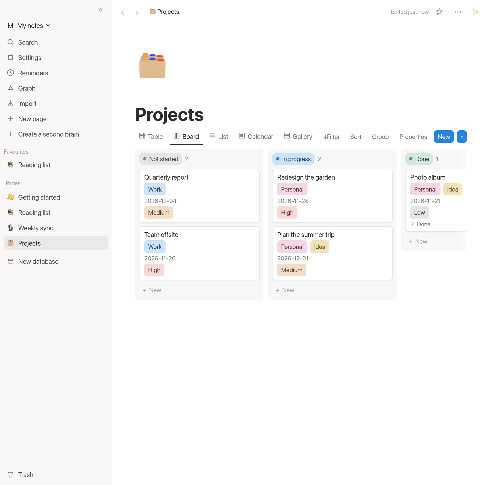
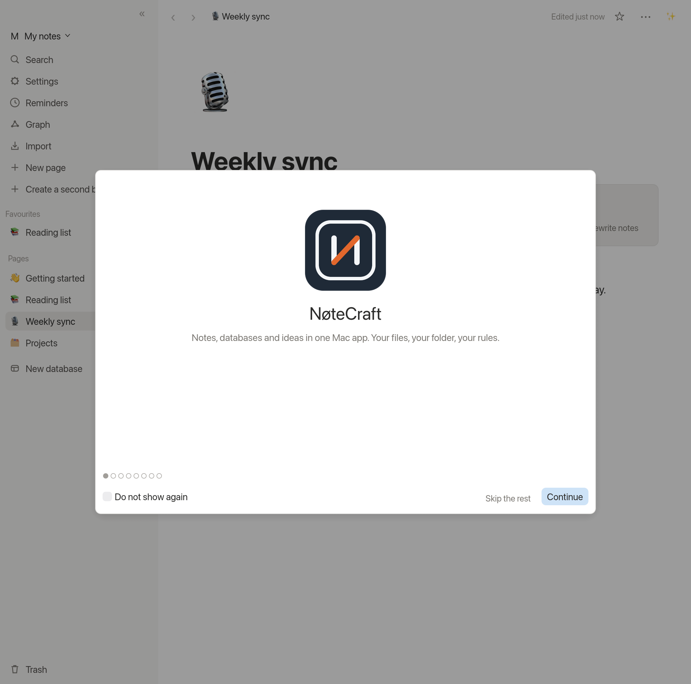
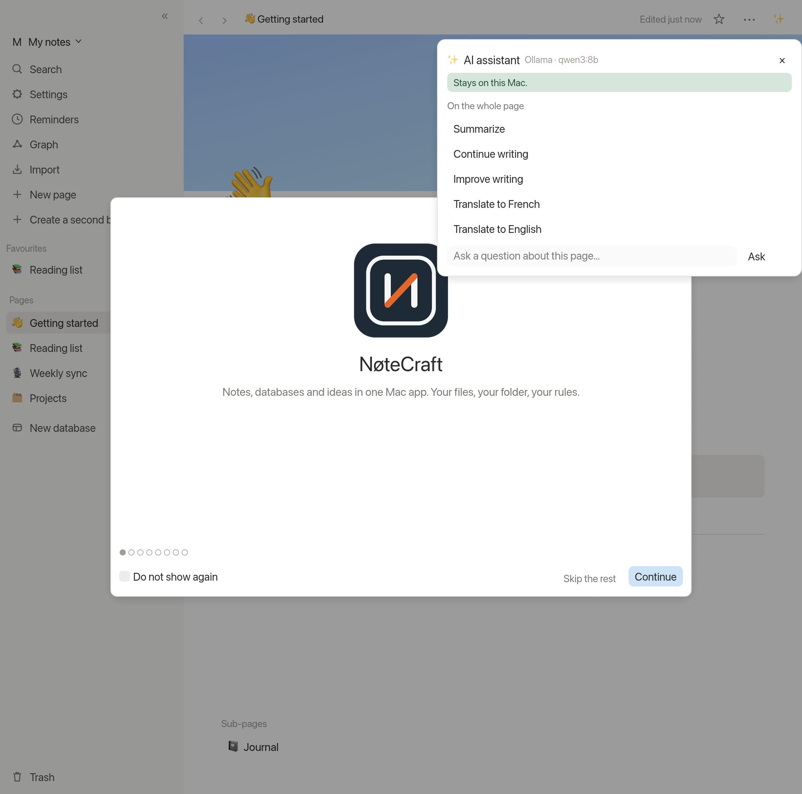

# NøteCraft

**Notes, tables and ideas in one fast Mac app. Your files, your folder, your rules.**

No account. No tracking. No subscription. Works offline.

<a href="../../releases/latest"><b>Download for Mac</b></a> · Apple silicon, macOS 11 or later

## At a glance

## Why you will like it

| | |
|---|---|
| **Your notes stay yours** | Every page is a plain Markdown file in a folder you choose. Open it with any app, back it up like any folder, sync it with iCloud Drive, Dropbox or kDrive. If you stop using NøteCraft, nothing is locked in. |
| **Private by design** | No account, no telemetry. Private pages are encrypted with your passphrase. Your AI keys stay in the macOS Keychain. |
| **Instant** | A native app written in Rust. 10,000 pages open in under a second and search answers as you type. |
| **AI on your terms** | Run Ollama on your Mac, or bring your own Claude, ChatGPT or Grok key. You see every result before anything changes. Claude Desktop and Claude Code can work on your notes through MCP, with the permissions you set. |
| **More than notes** | Databases with seven views, meeting notes transcribed on your Mac, equations, diagrams, reminders, presentations. |

## See it in action

| Databases | Meeting notes |
|---|---|
|  |  |
| **AI assistant** | **Dark mode** |
|  |  |

More views: [table](docs/screenshots/table.png), [calendar](docs/screenshots/calendar.png), [tabs](docs/screenshots/tabs.png), [presentation](docs/screenshots/present.png), [reminders](docs/screenshots/reminder.png).

## Get started

1. Download the DMG from the [latest release](../../releases/latest).
2. Drag **NøteCraft** into **Applications**.
3. First launch: the app is not signed with an Apple developer certificate yet, so macOS blocks it once. Right-click the app and choose **Open**; if that is not offered, open **System Settings, Privacy & Security** and click **Open Anyway**.
4. A four step assistant guides you: language, folder (a recommended `NoteCraft` folder in Documents, or any folder you pick), AI and meetings, each optional and explained. Then a tour of everything the app can do opens. Prefer another place for your notes? Choose any folder, and import your notes from Evernote, Obsidian, Bear, Joplin, Word, HTML or CSV once you are in.
5. Nothing is downloaded behind your back. Speech models for meeting notes, and AI engines, are offered when you first need them, with their size, and you decide.

## Learn more

- [User guide](docs/user-guide.md): everything the app does, shortcuts, how your data is handled.
- [Technical guide](docs/technical.md) and [architecture](docs/architecture.md): build instructions, file format, sync, the MCP server.
- [Changelog](CHANGELOG.md)

## License

NoteCraft is free for any non-commercial use (personal, study, hobby, research, charities, schools), under the [PolyForm Noncommercial License 1.0.0](LICENSE). You may use, modify and share it under those terms. Commercial use requires a separate licence from the author.

Third-party components keep their own licences, listed in [THIRD_PARTY_MODELS.md](THIRD_PARTY_MODELS.md) and [THIRD_PARTY_FONTS.md](THIRD_PARTY_FONTS.md).

Contributions are welcome. By submitting one, you agree that it is released under the same licence and that the author may relicense it, including commercially.

The name and logo "NoteCraft" are not covered by the licence.
